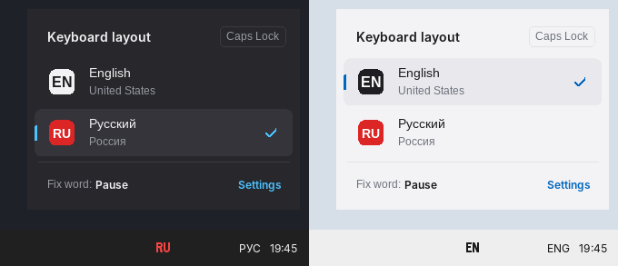
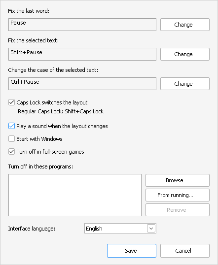

<p align="right"><b>English</b> · <a href="README.ru.md">Русский</a></p>

# KeySwitch

Typed `ghbdtn` instead of `привет`? Press **Pause**.

A minimalist keyboard layout switcher for Windows 10 and 11.

**[⬇ Download](../../releases/latest)** · **[Read the code](src/keyswitch.cpp)**

<p align="center">
  
</p>

## Free. Forever.

I made KeySwitch for myself because I was tired of heavy switchers with dictionaries that decide what I meant to type. If it's useful to you too, I'm glad. No ads, no subscriptions, no data collection.

## Check it yourself

All the code is in one file of about 3,700 lines, with no third-party libraries. You can read it yourself and check: it never goes online and never logs anything. `KeySwitch.exe` is built by GitHub straight from this code, and the release page shows exactly which version it came from.

## Tiny

One 410 KB file. No installation, no frameworks, no background services. About 3 MB of memory and 0% CPU while you're not pressing anything.

## Why no dictionaries

Punto Switcher, Caramba and similar tools try to guess the layout for you. Sometimes that's handy, but they misfire on abbreviations, logins, code and slang, and you end up fixing the fix.

KeySwitch does nothing until you ask. You can see when you've typed in the wrong layout. One key, and the text is fixed.

## Keys

| Action | Default |
|---|---|
| Fix the last word | `Pause` |
| Fix the selected text | `Ctrl+Pause` |
| Change the case of the selected text | `Shift+Pause` |
| Switch the layout | `Caps Lock` |
| Open Settings | `Ctrl+Shift+Pause` |

Regular Caps Lock is `Shift+Caps Lock`. Every hotkey can be changed in Settings.

## What else it does

- **Converts punctuation by key, as you pressed it.** `Ghbdtn?` → `Привет,`, `Rfr ltkf&` → `Как дела?`. A comma or period at the end of a word stays as is: `Ghbdtn, rfr` → `Привет, как`.
- **Press again to cycle.** The word moves to the next layout, and the case goes lower → Sentence case → UPPER.
- **Keep typing right away.** After a fix the cursor sits at the end of the text.
- **The layout in the tray.** RU in red, EN in black (white on a dark taskbar), grey when KeySwitch is off. Hover over it to see all layouts and switch with a click.
- **The tray icon can be hidden.** Settings then open with `Ctrl+Shift+Pause` or by running `KeySwitch.exe` again.
- **A soft sound** when the layout changes. Can be turned off.
- **Stays out of games.** Turns itself off in full-screen games.
- **Exceptions.** Programs where KeySwitch stays off, added with *Browse…*, from running programs, or right from the tray menu.
- **Works with any layouts** installed in Windows: Russian, Ukrainian, Greek and others.
- **English or Russian interface**, from your Windows language or chosen in Settings.
- **Light and dark theme**, following Windows. Changes in Settings apply instantly.

<p align="center">
  
</p>

## Installation

1. Download `KeySwitch.exe` from the [releases page](../../releases/latest).
2. Put it in any folder and run it. The current layout (EN or RU) appears in the system tray.
3. Double-click it to open Settings. You can turn on *Start with Windows* there.

Requires 64-bit Windows 10 or 11. Also runs on Windows 11 on ARM (for example, Parallels on a Mac).

The exe isn't digitally signed, so Windows SmartScreen may warn you on the first run. Click *More info*, then *Run anyway*.

## Feedback

Found a bug, missing something, or want something removed? Tell me, I read everything.

- **[Report a bug](../../issues/new?template=bug_report.yml)**
- **[Suggest an idea](../../issues/new?template=feature_request.yml)**

English or Russian is fine. If you like KeySwitch, a ⭐ helps others find it.

<details>
<summary><b>More about privacy</b></summary>

KeySwitch sees your keystrokes, otherwise it couldn't know which word to fix. That said:

- there's no networking code: it sends nothing and never checks for updates;
- only the keys of the current word in the current window are kept in memory, and they're cleared on Enter, a mouse click or a window change;
- in password fields it keeps nothing at all and fixes nothing (in the fields Windows can recognize as password fields: regular programs and browsers);
- the only file it writes is the settings file: `%APPDATA%\KeySwitch\config.ini`.

</details>

<details>
<summary><b>More than two layouts</b></summary>

KeySwitch works with all layouts installed in Windows and goes through them in the same order as Windows does.

- **Caps Lock** switches to the next layout: EN → RU → UA → EN.
- **Pause** moves the word to the next layout in the list. Press again to go further.
- **Ctrl+Pause** finds out which layout the selected text was typed in and moves it to the next one.

So the order matters. If your list is EN, RU, UA, then `ghbdtn` + Pause gives `привет` right away. If it is EN, UA, RU, the first press gives the Ukrainian variant and the second gives `привет`. To change the order, open Windows Settings → Time & language → Language & region and drag the languages.

In the tray, English is shown in black (white on a dark taskbar), any other layout in red: RU, UA, DE and so on.

</details>

<details>
<summary><b>Tray menu</b></summary>

- **Turn off in “…exe”**: add the current program to the exceptions. Again: **Turn on in “…exe”**.
- **Pause KeySwitch**: turn everything off for a while.
- **Settings…**, **About**, **Exit**.

</details>

<details>
<summary><b>Limitations</b></summary>

- In windows running as administrator, KeySwitch works only if it runs as administrator too. That's a Windows security rule.
- In some windowed games and old programs the fix may not work. Add them to the exceptions.
- Mac keyboards have no Pause key. Assign other hotkeys in Settings.

</details>

<details>
<summary><b>Building from source</b></summary>

MinGW-w64 (this is how GitHub builds it):

```
cd src
windres keyswitch.rc -O coff -o keyswitch_res.o
g++ -std=c++17 -O2 -s -municode -mwindows -static keyswitch.cpp keyswitch_res.o -o KeySwitch.exe -luser32 -lshell32 -ladvapi32 -lgdi32 -lwinmm -lcomdlg32 -lgdiplus -lole32
```

Visual Studio (Developer Command Prompt):

```
cd src
rc keyswitch.rc
cl /O2 /EHsc /utf-8 /DUNICODE /D_UNICODE keyswitch.cpp keyswitch.res /Fe:KeySwitch.exe /link /SUBSYSTEM:WINDOWS /MANIFEST:NO
```

</details>

## License

[MIT](LICENSE) © 2026 NSMRK
