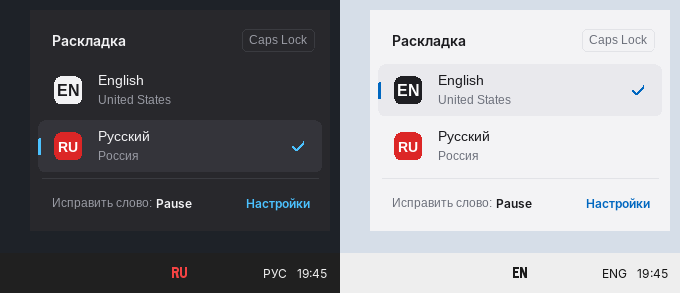
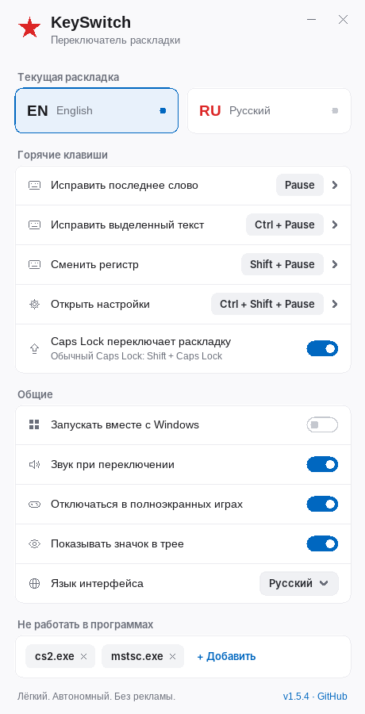

<p align="right"><a href="README.md">English</a> · <b>Русский</b></p>

# KeySwitch

Набрал «ghbdtn» вместо «привет»? Нажми **Pause**.

Минималистичный переключатель раскладки для Windows 10 и 11.

**[⬇ Скачать](../../releases/latest)** · **[Посмотреть код](src/keyswitch.cpp)**

<p align="center">
  
</p>

## Бесплатно. Навсегда.

Я сделал KeySwitch для себя, потому что устал от тяжёлых переключателей со словарями, которые сами решают, что я хотел написать. Если он пригодится и вам, буду рад. Без рекламы, подписок и сбора данных.

## Можно проверить самому

Весь код лежит в одном файле примерно на 3 700 строк, без сторонних библиотек. Его можно прочитать и убедиться: программа не выходит в интернет и ничего не записывает. А `KeySwitch.exe` собирает сам GitHub прямо из этого кода, и на странице релиза видно, из какой именно версии.

## Крошечный

Один файл 370 КБ. Без установки, без фреймворков и фоновых служб. Около 3 МБ памяти и 0% процессора, пока вы ничего не нажимаете.

## Почему без словарей

Punto Switcher, Caramba и похожие программы пытаются угадать раскладку сами. Иногда это удобно, но они ошибаются на аббревиатурах, логинах, коде и сленге, и приходится исправлять исправление.

KeySwitch ничего не делает без команды. Вы сами видите, что набрали не в той раскладке. Одна клавиша, и текст исправлен.

## Клавиши

| Действие | По умолчанию |
|---|---|
| Исправить последнее слово | `Pause` |
| Исправить выделенный текст | `Ctrl+Pause` |
| Сменить регистр выделенного текста | `Shift+Pause` |
| Переключить раскладку | `Caps Lock` |
| Открыть настройки | `Ctrl+Shift+Pause` |

Обычный Caps Lock включается через `Shift+Caps Lock`. Любое сочетание можно поменять в настройках.

## Что ещё умеет

- **Знаки не трогает.** Буквы меняются, знаки остаются как набраны: «дела?» → «ltkf?».
- **Повтор по кругу.** Нажмите ещё раз, и слово перейдёт в следующую раскладку, а регистр сменится: строчные → Как в предложении → ЗАГЛАВНЫЕ.
- **Сразу печатайте дальше.** После исправления курсор стоит в конце текста.
- **Раскладка в трее.** RU красным, EN чёрным (на тёмной панели белым), серым, если программа отключена. При наведении появляется панель со всеми раскладками, переключать можно кликом.
- **Значок в трее можно скрыть.** Тогда настройки открываются по `Ctrl+Shift+Pause` или повторным запуском `KeySwitch.exe`.
- **Тихий звук** при переключении раскладки. Отключается.
- **Не мешает в играх.** В полноэкранных играх отключается сам.
- **Исключения.** Программы, в которых KeySwitch не работает, добавляются кнопкой «Обзор…», из списка запущенных или прямо из меню в трее.
- **Работает с любыми раскладками** Windows: русской, украинской, греческой и другими.
- **Интерфейс на русском или английском**, по языку Windows или на выбор.
- **Светлая и тёмная тема**, как в Windows. Изменения в настройках применяются сразу.

<p align="center">
  
</p>

## Установка

1. Скачайте `KeySwitch.exe` со страницы [релизов](../../releases/latest).
2. Положите в любую папку и запустите. В трее появится текущая раскладка (EN или RU).
3. Двойной клик по ней открывает настройки. Там же можно включить автозапуск.

Нужна Windows 10 или 11, 64-битная. На Windows 11 для ARM (например, Parallels на Mac) тоже работает.

Exe не подписан цифровой подписью, поэтому при первом запуске Windows может показать предупреждение SmartScreen. Нажмите «Подробнее», затем «Выполнить в любом случае».

## Обратная связь

Нашли ошибку, чего-то не хватает или что-то лишнее? Напишите, я читаю всё.

- **[Сообщить об ошибке](../../issues/new?template=bug_report.yml)**
- **[Предложить идею](../../issues/new?template=feature_request.yml)**

Можно писать по-русски или по-английски. Если KeySwitch понравился, поставьте ⭐, так его найдут другие.

<details>
<summary><b>Подробнее о конфиденциальности</b></summary>

KeySwitch видит нажатия клавиш, иначе он не узнал бы, какое слово исправлять. При этом:

- в программе нет сетевого кода: она ничего не отправляет и не проверяет обновления;
- в памяти хранятся только клавиши текущего слова в текущем окне, они стираются при Enter, клике мышью или смене окна;
- на диск пишутся только настройки: `%APPDATA%\KeySwitch\config.ini`.

</details>

<details>
<summary><b>Меню в трее</b></summary>

- **Отключать в «…exe»**: добавить текущую программу в исключения. Повторно: **Включить в «…exe»**.
- **Приостановить**: временно выключить всё.
- **Настройки…**, **О программе**, **Выход**.

</details>

<details>
<summary><b>Ограничения</b></summary>

- В окнах, запущенных от имени администратора, KeySwitch работает, только если сам запущен от администратора. Это правило защиты Windows.
- В некоторых оконных играх и старых программах исправление может не сработать. Добавьте их в исключения.
- На клавиатуре Mac нет клавиши Pause. Назначьте другие сочетания в настройках.

</details>

<details>
<summary><b>Сборка из исходников</b></summary>

MinGW-w64 (так собирает GitHub):

```
cd src
windres keyswitch.rc -O coff -o keyswitch_res.o
g++ -std=c++17 -O2 -s -municode -mwindows -static keyswitch.cpp keyswitch_res.o -o KeySwitch.exe -luser32 -lshell32 -ladvapi32 -lgdi32 -lwinmm -lcomdlg32 -lgdiplus -lole32
```

Visual Studio (Developer Command Prompt):

```
cd src
rc keyswitch.rc
cl /O2 /EHsc /utf-8 /DUNICODE /D_UNICODE keyswitch.cpp keyswitch.res /Fe:KeySwitch.exe /link /SUBSYSTEM:WINDOWS /MANIFEST:NO
```

</details>

## Лицензия

[MIT](LICENSE) © 2026 NSMRK
